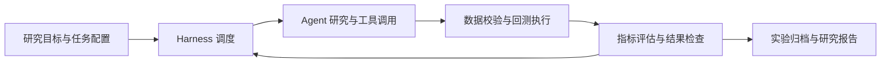

# binance

面向热门加密资产的量化研究项目，逐步构建从行情数据、策略研究、组合回测到实验评估的完整工作流，并通过 **Agent Harness** 组织和追踪研究任务。

当前处于早期开发阶段：已有行情下载脚本、历史数据快照和回测框架草稿；Agent Harness 尚未实现。

## 项目目标

- **量化研究**：围绕主流加密资产开展收益、波动率、相关性、动量、均值回归和横截面因子研究。
- **组合回测**：支持多资产配置、调仓规则、手续费和滑点，并逐步补齐绩效指标与基准比较。
- **可复现实验**：记录数据版本、代码版本、参数、运行环境和结果，使每个研究结论都能追溯和复跑。
- **Agent Harness**：建立统一的任务、工具和评估接口，让 Agent 在明确的执行边界内完成研究、运行实验和整理报告。

## 当前进展

| 模块 | 状态 | 说明 |
| --- | --- | --- |
| 行情下载 | 已有实现 | 从 Binance 公共行情接口分页下载 K 线，支持重试、去重、UTC 时间处理，仅保存已收盘 K 线 |
| 历史数据 | 已有快照 | 9 个 USDT 交易对，分别保存 `1h` 和 `1d` CSV，共 18 个文件 |
| 数据加载 | 已有实现 | 按币种与时间范围读取、对齐开盘价和收盘价，异常价格设为 `NaN` 并发出警告 |
| 组合回测 | 开发中 | 已有配置和部分调仓逻辑，权重接口、交易记账和结果输出仍需完善 |
| Agent Harness | 规划中 | 任务调度、工具执行、实验追踪和评估系统尚未实现 |

当前研究池：`BTCUSDT`、`ETHUSDT`、`BNBUSDT`、`SOLUSDT`、`XRPUSDT`、`DOGEUSDT`、`ADAUSDT`、`TRXUSDT`、`LINKUSDT`。后续可按流动性和数据可用性调整。

## 目录结构

```text
binance/
├── README.md             # 项目说明与开发路线
├── pyproject.toml        # Python 项目配置与依赖
├── uv.lock               # 依赖锁定文件
├── .python-version       # 本地 Python 版本
├── main.py               # 预留入口，目前仅输出欢迎信息
├── download_binance.py   # 历史 K 线下载脚本
├── backtesting.py        # 数据加载与组合回测草稿
└── data/
    ├── BTCUSDT_1h.csv
    ├── BTCUSDT_1d.csv
    └── ...
```

## 快速开始

在项目目录执行。需要 Python 3.12+ 和 `uv`。

```bash
uv sync --locked
```

依赖包括 `numpy`、`pandas` 和 `requests`，具体版本由 `uv.lock` 锁定。

### 下载行情

先修改 `download_binance.py` 顶部的配置：

| 配置 | 用途 | 当前设置 |
| --- | --- | --- |
| `SYMBOLS` | 下载的交易对 | 上述 9 个 USDT 交易对 |
| `INTERVALS` | K 线频率 | `1h`、`1d` |
| `START` | 开始时间 | `2020-01-01` |
| `END` | 结束时间，不包含该时点 | `None`，下载至当前可用的已收盘 K 线 |
| `OUTPUT_DIR` | CSV 输出目录 | `/Users/bohanhou/binance/data` |

```bash
uv run download_binance.py
```

脚本使用 `https://data-api.binance.vision` 的公共行情接口，不需要 API Key。相同交易对和频率的文件会被重新下载并覆盖。

CSV 文件名格式为 `{SYMBOL}_{INTERVAL}.csv`，字段包括：

```text
open_time, open, high, low, close, volume, close_time,
quote_volume, trade_count, taker_buy_base_volume, taker_buy_quote_volume
```

时间统一为 UTC。现有快照中的日线最后开盘时间为 `2026-11-08 00:00 UTC`，小时线最后开盘时间为 `2026-11-09 21:00 UTC`；SOL 数据从 2020 年 8 月开始，其余币种从 2020 年 1 月开始。数据快照随本次初始提交保留，后续下载会改变文件内容。

### 查看数据加载结果

在 `backtesting.py` 的 `config` 中设置研究池、时间范围、数据目录和频率后执行：

```bash
uv run backtesting.py
```

当前脚本只会加载并打印数据，不会自动运行完整回测。`run_backtest(config)` 在 `weights=None` 时返回数据且 `summary=None`；配置非空权重后的交易流程仍未完成，暂不能用于策略绩效评估。

`missing_data` 配置项目前尚未接入严格报错逻辑：实际加载行为是发出警告，并将缺失或无效价格保留为 `NaN`。

下载脚本和回测配置目前使用本机绝对路径。在其他机器使用时，需要分别修改 `OUTPUT_DIR` 和 `config["data_dir"]`。

## 量化研究路线

1. **数据质量与研究池**：检查重复、缺口、上市时间和异常价格，定义各时间点可交易的资产集合。
2. **基准策略**：建立买入持有、等权组合和定期再平衡基准，先验证交易记账与成本计算。
3. **因子与策略**：研究时间序列动量、横截面动量、均值回归、波动率调整和成交量特征。
4. **组合与风险**：探索仓位约束、波动率目标、资产相关性和调仓频率对结果的影响。
5. **评估与复现**：输出收益、最大回撤、波动率、夏普比率、换手率和成本明细，并进行样本外与滚动验证。

研究过程中需要明确特征可用时间和成交时间，避免使用未来数据；币种筛选与缺失数据处理也应成为实验配置的一部分。

## Agent Harness 规划

Harness 将负责把研究目标转成可执行、可检查、可恢复的实验流程。以下为目标设计，当前仓库尚无对应实现。



计划建设的核心能力：

| 能力 | 计划内容 |
| --- | --- |
| 任务协议 | 定义研究问题、输入数据、约束、验收标准和输出格式 |
| 执行循环 | 管理规划、工具调用、结果观察和后续步骤，记录任务状态 |
| 工具接口 | 统一封装数据读取、特征计算、回测运行和指标评估 |
| 执行边界 | 配置可用工具、文件访问范围、时间与调用预算、超时和重试 |
| 实验追踪 | 保存任务 ID、代码提交、数据标识、参数、随机种子、日志和产物 |
| 自动评估 | 校验数据、交易约束、绩效指标和基准对比，保留失败原因 |
| 恢复与复跑 | 从已保存状态恢复中断任务，并支持按实验配置重新执行 |

首个版本优先完成单个 Agent 的完整研究循环；后续再按需要扩展研究、实现和评估等角色。

## 开发清单

- [x] 初始化 Python 项目与依赖锁定。
- [x] 下载 9 个交易对的小时线与日线历史数据。
- [x] 实现基础价格加载与时间索引对齐。
- [ ] 统一路径与配置入口。
- [ ] 完善缺失数据策略、权重协议和调仓逻辑。
- [ ] 完成交易成本、现金与持仓记账、净值曲线和绩效汇总。
- [ ] 增加关键回测场景验证与基准策略。
- [ ] 建立实验配置与产物归档规范。
- [ ] 实现 Agent Harness 的任务循环、工具接口和运行记录。
- [ ] 接入自动评估与研究报告生成。
